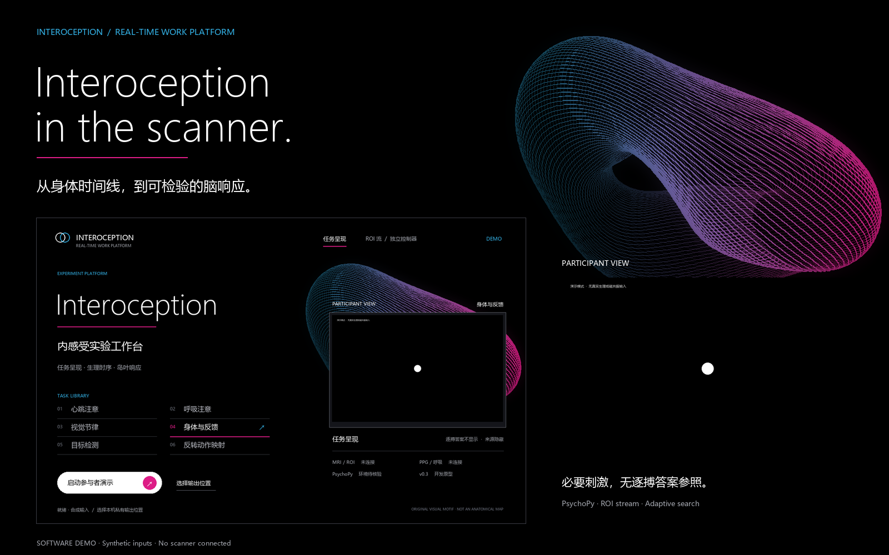
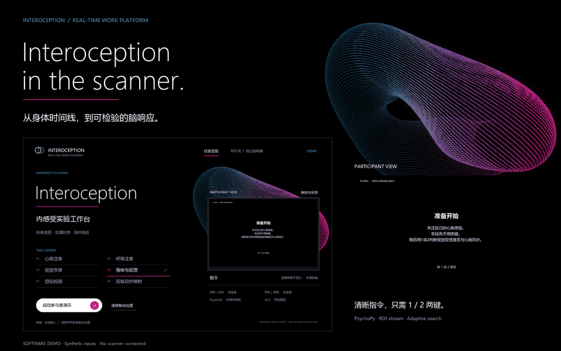
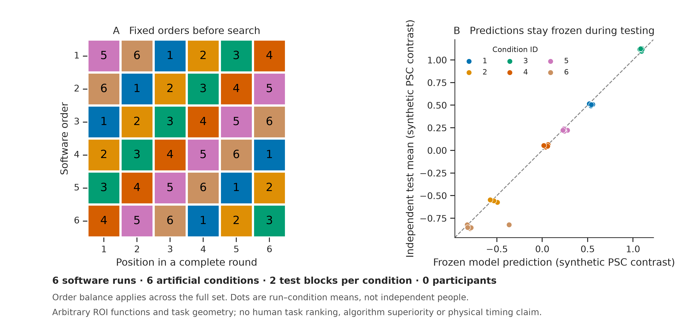

# Real-Time Interoception Work Platform

**Body timing. Task space. Reproducible responses.**



[Watch the film ↗](docs/assets/program/walkthrough.mp4) · [Explore the screens](docs/program-gallery.md) · [中文研究方案](docs/interoception-protocol-2026-10.zh-CN.md) · [Run the program](experiments/interoception/README.md)

Which insular responses depend on the timing of bodily signals, and which can
also be explained by attention, external events or action requirements?

This standalone experimental program combines controlled tasks, predefined
insular targets, neuroadaptive search and independent response-profile tests.
It includes the presentation software, controller, interfaces and synthetic
verification needed to develop that experiment. Site physiology and scanner
adapters remain to be connected and validated.

## See the program



**A 20-second software demonstration.** Inputs, triggers and responses are
synthetic. The film uses the actual presentation state machine and the same
artwork used by the native launcher and PsychoPy prompt screens. It is not a
human recording or a hardware timing test. [MP4](docs/assets/program/walkthrough.mp4)
· [Screenshots and provenance](docs/assets/program/provenance.synthetic.json).

The film and screen gallery use the seven-point response contract. Rating
pages retain the question and scale; operating instructions appear before
the task. Earlier binary validation records retain their historical labels.

The operator gets a task library and connection status. The participant gets
clear instructions, the prescribed stimulus and the required response. No
second pulse display supplies the answer to a heartbeat-attention task.
Current and replay feedback share the same visual treatment. The participant
uses only the available **1/2 response-box panel**; synchrony and confidence
use **1–7 ordinal ratings** in fixed response windows. Key 1 moves left and
key 2 moves right, with repeated adjustments allowed. The cursor starts at 4
without a recorded answer. The window saves the final selected level after
interaction; leaving 4 untouched is missing. Selecting 4 requires moving away
and back. No confirmation key is needed. The other hand remains with finger
PPG and the emergency squeeze bulb. [Device mapping and controls](experiments/interoception/README.md).

The seven levels express order, not equal numerical distances. The rating
contract is versioned separately from the predefined III–IV MRI target and
from the Go/No-go responses in the task library.

## From a question to a test

| Stage | Question | In this repository |
|---|---|---|
| **Align** | Which body event was available, and when? | Causal event/clock contracts and a site-adapter interface; live physiology remains pending |
| **Present** | What does the participant attend to? | Six-family demonstration, source-blind four-condition probe, fixed response pages |
| **Estimate** | How do predefined regions respond? | Native-grid ROI extraction, incremental GLM, separate III and IV estimates |
| **Search** | Which condition should be sampled next? | Actual GP regression, EI or GP-UCB, versioned task space and complete decision records |
| **Verify** | Does the response profile repeat? | Independent resets, frozen optimizer and a separate test GLM |

The proposed starting target is **task-evoked beta III − beta IV**. It is a
regional contrast, not an interoceptive-accuracy score. The [2026 Nature
study](https://www.nature.com/articles/s41586-026-11175-2) supplies candidate
functional-region priors; [Lorenz et al., 2018](https://www.nature.com/articles/s41467-018-03657-3)
and [2021](https://doi.org/10.1093/brain/awab109) supply the neuroadaptive-method
baseline. [Read the method-by-method comparison](docs/romy-replication-map-2026-10.zh-CN.md).

## Run it locally

For the headless controller, use Python 3.10 or later and install the small
core dependency set:

```bash
python -m pip install -r requirements.txt
```

For the native interface, use a separately installed
[PsychoPy environment](https://www.psychopy.org/download.html) with Pillow.
Run from this repository root with that environment's Python:

```bash
python -m experiments.interoception.launcher
```

Or review the four-condition presentation with synthetic inputs:

```bash
python -m experiments.interoception.run_presentation --simulate --probe-four --quick --out /private/new_presentation_demo
```

Choose a **new output directory outside this repository**. On Windows, use
for example `D:/InteroceptionPrivate/presentation_demo_01`. For an unattended
UI smoke check, add `--autoplay`; every generated response remains synthetic.

The controller can also run without a display:

```bash
python -m experiments.interoception.simulate_neuroadaptive --out /private/new_controller_demo
```

[Full setup and controls](experiments/interoception/README.md) ·
[ROI / JSONL / PsychoPy interfaces](docs/interoception-interfaces-2026-10.md)

PsychoPy is not installed by the headless requirements file. The native
demonstration was checked with PsychoPy 2025.1.1; installing a newer version
does not replace display, response-device or site calibration. ROI file input
uses NiBabel. Figure rebuilding additionally uses the optional
`requirements-figures.txt` dependencies.

## What the evidence currently supports

**Current software checks:** 213 tests pass, including repeated seven-point
adjustments, missing responses, frozen predictions, separate test GLMs and
prespecified repeated validation orders. Six synthetic software runs retain
all 12 test blocks per run, instead of collapsing repeated conditions.

The native PsychoPy controller also completed six development and six frozen
test blocks on its actual software clock, with matching start/end receipts.
The final seven-point window was checked separately after the visual polish.
[Current verification records](docs/software-verification-2026-10.md).



[Independent validation plan](docs/independent-validation-2026-10.zh-CN.md)
· [Synthetic report](results/independent_profile_validation_20261026.synthetic.json).
The points are software run–condition means from arbitrary response functions,
not people or evidence of a biological task ranking.

Real-time scanner input, causal physiology adapters,
independent task geometry, ROI visibility, licensed GradCPT photographs and
physical display/response timing still require site development and pilots.
The 18 candidate presets are a software registry, not 18 validated human tasks.
The CLI presenter is deliberately restricted to simulation.

[Earlier software verification](results/interoception_interface_validation_20261026.json)
· [Earlier binary presentation verification](results/interoception_presentation_validation_20261026.json)
· [Seven-point software checks](results/seven_point_software_validation_20261026.synthetic.json)
· [Native controller integration](results/native_controller_validation_20261026.synthetic.json)
· [Actual PsychoPy screen](docs/assets/program/actual-psychopy-rating.synthetic.png)
· [Scientific plan](docs/interoception-protocol-2026-10.zh-CN.md)

The earlier physiology measurement project stays in its
[separate repository snapshot](https://github.com/YaoZeLiu0417/uhf-fmri-qc-notes/tree/b0a60bef27637a727681571996ab927aee61b4f9).
Its measurement code, human data and aggregate results are not bundled here.
See [source and scope](SOURCE.md) for the separation and retained licence.

## Design and reproducibility

The visual direction studies the spacious typography, black fields and organic
depth of [Alto Neuroscience](https://altoneuroscience.com/). All program artwork
and the parametric shell are original. The shell is a design motif, not a brain
reconstruction or measured insular manifold. No Alto logo, photograph or
illustration is redistributed. Participant measurement fields remain controlled
and achromatic. [Design decisions](docs/program-design-2026-10.md).

Run the software checks:

```bash
python -m pip install -r requirements-dev.txt
python -m pytest tests -q
```

Rebuild the program media with Pillow; pass an installed FFmpeg executable
for the optional H.264 film:

```bash
python scripts/export_interoception_demo.py --ffmpeg /path/to/ffmpeg
```

Human MRI, physiology, identifiers and trial-level logs stay outside the public
repository. Published Nature masks remain in the [authors' repository](https://github.com/LBCN-Stanford/Nature2026).

The present plan starts with regional questions on available clinical MRI.
Ultra-high-field, layer-specific and live closed-loop performance have not
been established by this software demonstration. [MIT licence](LICENSE).
