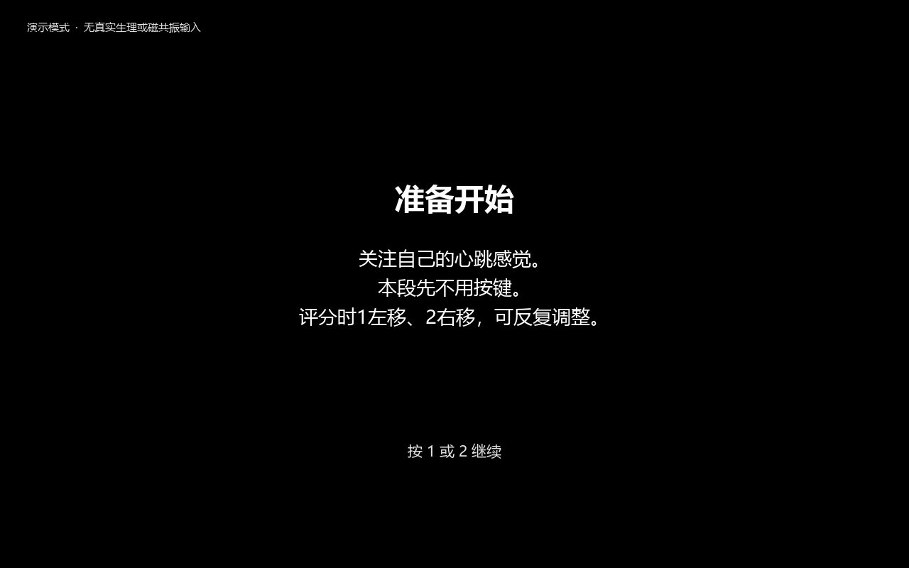
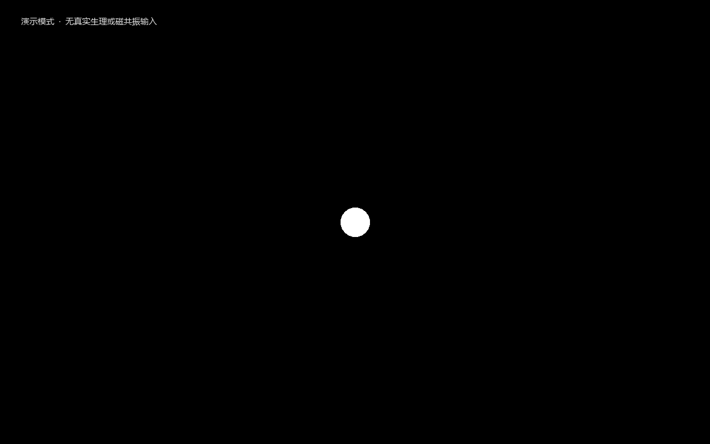
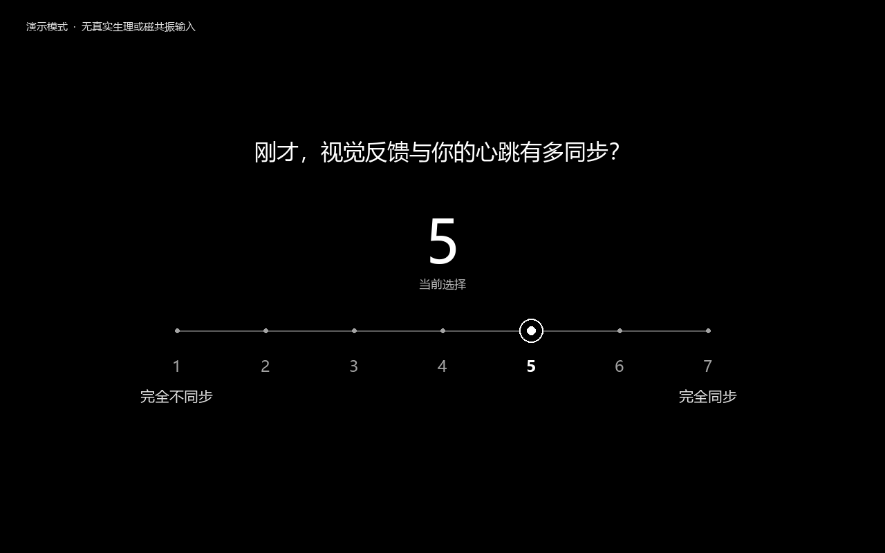
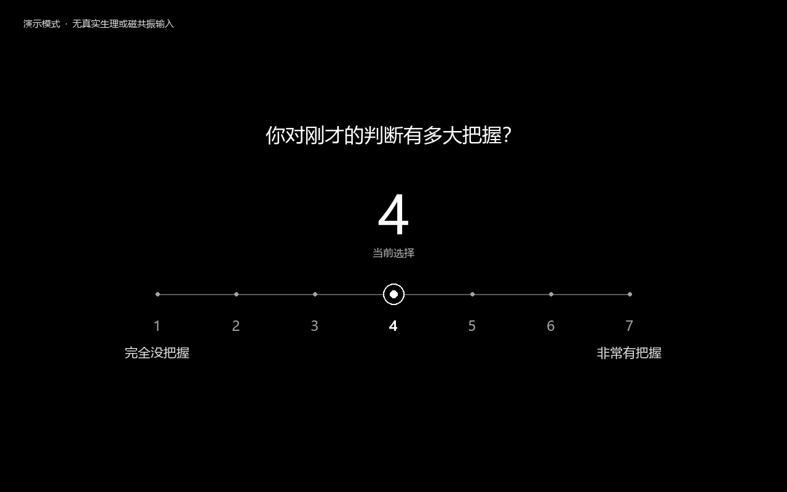

# Interoception · program screens

Black fields, light typography and a single original three-dimensional motif.
These are the shared program renderer's screens, driven by the actual
presentation state machine with synthetic inputs.

[Watch the 20-second film](assets/program/walkthrough.mp4) ·
[Animated walkthrough](assets/program/walkthrough.gif) ·
[Run the program](../experiments/interoception/README.md)

## Operator workspace

## Participant instructions

## A single prescribed feedback cue

## Two buttons, seven ordered levels

The specified response protocol uses 1 to move left and 2 to move right on
levels 1–7. It starts at 4 with no answer recorded. Repeated adjustments are
allowed until the fixed window ends; no press remains missing. To select 4,
move away and back. No confirmation key is needed. Device, model and source
labels stay on the operator side. Response pages show the question and scale;
operating instructions appear before the task.

## Native PsychoPy window check

This capture is from a native PsychoPy window with synthetic autoplay. It
shows an adjustment in progress, rather than the final saved rating.
Capturing interrupts frame performance; it does not validate physical display
or response latency. [Earlier binary verification](../results/interoception_presentation_validation_20261026.json)
· [Current seven-point window check](../results/seven_point_presentation_validation_20261026.synthetic.json)
· [Media provenance](assets/program/provenance.synthetic.json).

For the local full-screen exhibition, open
`docs/assets/program/index.preview.html` from your checkout in a browser.
